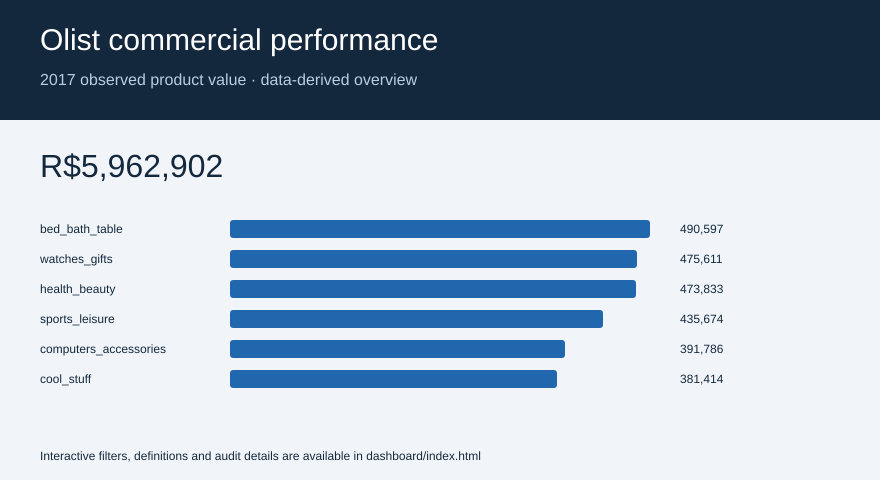

# Olist Commercial Performance Analysis

Which product categories and customer states account for the most value from delivered orders? How do those figures change over comparable periods? This project uses SQL to answer those questions with the Brazilian Olist dataset. It includes reconciled metrics, an offline dashboard, and a Power BI import guide. The analysis cannot establish profit, recurring seasonality, or the effect of marketing.

## Explore the results

- Open the [interactive dashboard](dashboard/index.html) in a browser. The HTML contains all the data it needs.
- [Verified findings](analysis_report.md) and [data quality checks](dashboard/quality.json).
- [Authoritative SQL](portfolio_queries.sql), [data model / KPI definitions](docs/DATA_MODEL.md), [Power BI guide](docs/POWER_BI.md), [PRD](PRD.md).

## Verified snapshot

| Metric | Value |
| --- | --- |
| Delivered orders | 96,478 |
| Product value, excluding freight | R$13,221,498.11 |
| Payment value, including freight/adjustments | R$15,422,461.77 |
| Items without a known category | 1,537 (included in totals) |
| Top-ten category share of product value | 62.4% |

The previous share of 63.3% used a narrower denominator. The 62.4% above uses the full product value of delivered orders, including items without a known category. Pooling September and October across partial years cannot establish a seasonal dip. To compare equivalent periods, use January through July 2017 and the same months in 2018. The transactions alone do not establish source completeness.

## Reproduce

The exporter needs Python 3.10+ and uses only its standard library.

1. Download the [Brazilian E-Commerce Public Dataset by Olist](https://www.kaggle.com/datasets/olistbr/brazilian-ecommerce) and place its CSV files in `dataset/`. Follow the dataset’s license and terms when using the CSVs. The repository does not redistribute them.
2. Use the existing `ecommerce.db`, or build a new one with `python ingest_dataset.py`.
3. Run `python build_portfolio.py --db ecommerce.db` (or `--db ecommerce_rebuilt.db`).
4. Open `dashboard/index.html` directly. Choose a period, state and category. Export the displayed table if needed.
5. Run `python -m unittest discover -s tests -v` for fixture-based regression checks without the real dataset.

The exporter opens the database in read-only mode. It checks for duplicate primary keys, orphan items, invalid prices, and delivered orders without items, then reconciles the totals. It writes aggregated CSV and JSON files, the dashboard HTML, and the report. The dashboard does not expose customer or order IDs.

## Decisions supported

- Review the categories with the highest sales value. Gather cost and margin data before moving budget.
- Separate observed marketplace growth from seasonality before planning promotions.
- Investigate delivery economics and customer acquisition before proposing regional expansion.

## Structure and boundaries

`portfolio_queries.sql` and `build_portfolio.py` generate the dashboard and verified results. `queries.sql` contains corrected exploratory examples. The dashboard skips `analysis.py` and the older PNG charts, whose captions about pooled months and causal effects have not been validated. The browser dashboard is ready to use. To build your own `.pbix`, follow [the Power BI guide](docs/POWER_BI.md) for the CSV exporter, relationships, DAX, and validation.

The analysis covers delivered orders only. Product value, payments, marketplace commission, and profit are separate measures. The dataset used here has no costs, acquisition spend, or experimental treatment data. When you filter by category, the dashboard disables the order count and average order value because an order can appear in multiple categories. The Power BI export has one row per item and supports a distinct count across categories.

## Repeatable verification

Review the commands in `ai-toolkit.json`, then run `python scripts/verify.py` in the project’s Python environment. The script checks local documentation links and runs those commands without a shell. It saves the results in `.verification/latest.json`, which Git ignores. Dashboard JavaScript and filter checks require Node.js on PATH. The local checks do not cover browser behavior, deployment, or live services. See AGENTS.md and CLAUDE.md for the project workflows.
