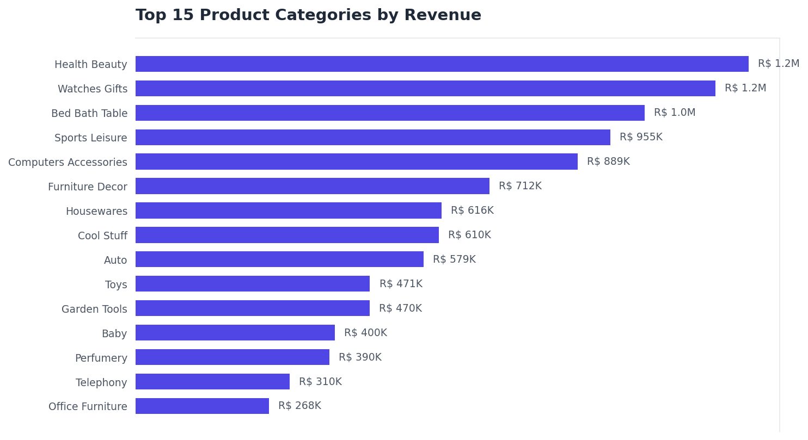
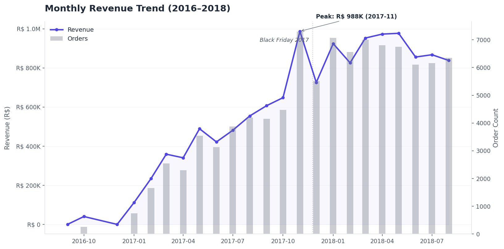
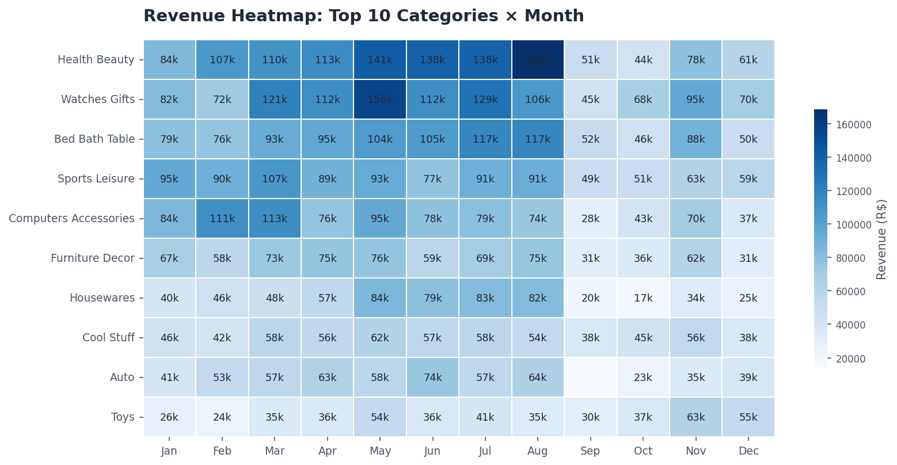
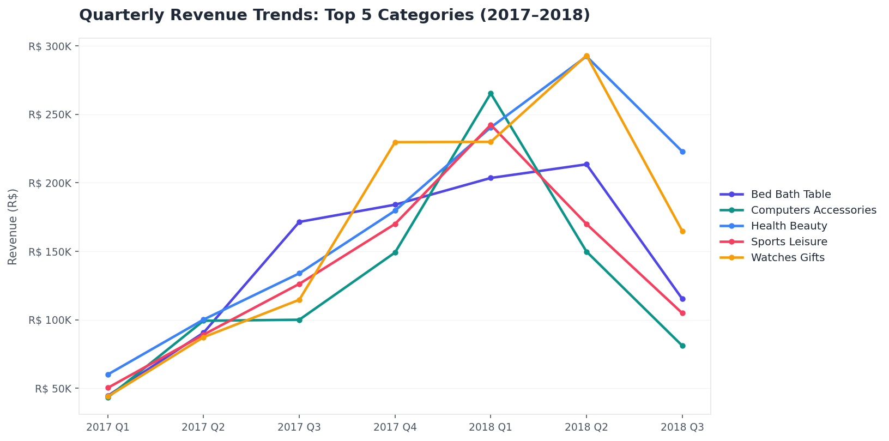
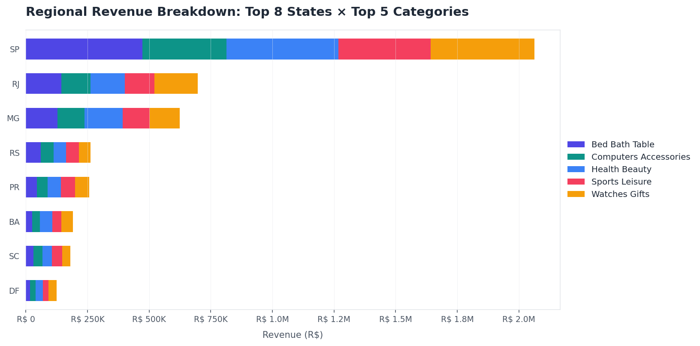

# E-Commerce Sales Analysis Report
## Brazilian Olist Dataset — Revenue by Category & Seasonal Patterns

**Author:** Data Analysis Portfolio Project
**Dataset:** [Brazilian E-Commerce Public Dataset by Olist](https://www.kaggle.com/datasets/olistbr/brazilian-ecommerce)
**Scope:** 96,478 delivered orders | R$13.2M revenue | Sept 2016 – Aug 2018
**Tools:** SQL (SQLite), Python (pandas, matplotlib, seaborn)

---

## Executive Summary

This analysis examines **100K+ e-commerce orders** from Olist, Brazil's largest department store marketplace. The data spans 2 years and covers product categories, customer geography, payment methods, and order timing.

**Key Findings:**
1. **Health & Beauty** and **Watches & Gifts** are the top revenue-generating categories (~R$1.2M each)
2. The **top 10 categories account for 63.3%** of total revenue, indicating high concentration
3. Revenue grew **~10× from Q1 2017 to Q2 2018**, with clear **Black Friday spikes** in November
4. **São Paulo (SP)** alone generates **38%** of all revenue
5. **Monday–Tuesday** are peak shopping days; weekends see 25% lower volume

---

## 1. Revenue by Product Category

### Top 15 Categories by Total Revenue

| Rank | Category | Revenue (R$) | Orders | Avg Item Price |
|------|----------|-------------|--------|----------------|
| 1 | Health & Beauty | 1,233,132 | 8,647 | R$37 |
| 2 | Watches & Gifts | 1,166,177 | 5,495 | R$62 |
| 3 | Bed, Bath & Table | 1,023,435 | 9,272 | R$47 |
| 4 | Sports & Leisure | 954,853 | 7,530 | R$40 |
| 5 | Computers & Accessories | 888,725 | 6,530 | R$55 |
| 6 | Furniture & Decor | 711,928 | 6,307 | R$39 |
| 7 | Housewares | 615,629 | 5,743 | R$33 |
| 8 | Cool Stuff | 610,204 | 3,559 | R$57 |
| 9 | Auto | 578,967 | 3,810 | R$45 |
| 10 | Toys | 471,286 | 3,804 | R$40 |

> [!IMPORTANT]
> **Revenue Concentration:** The top 10 categories capture **63.3%** of total revenue (R$8.3M out of R$13.2M), while the remaining 63 categories share only 36.7%.

### Highest Average Order Value Categories

Categories with highest AOV (minimum 50 orders) reveal a different picture:

| Category | Orders | AOV (R$) |
|----------|--------|----------|
| Computers | 177 | R$1,236 |
| Small Appliances (Home/Oven/Coffee) | 72 | R$647 |
| Home Appliances 2 | 227 | R$476 |
| Agro Industry & Commerce | 177 | R$399 |
| Musical Instruments | 611 | R$302 |

> [!NOTE]
> High-AOV categories like **Computers** (R$1,236 avg) generate less total revenue due to low volume (177 orders). This suggests an opportunity to drive growth through targeted marketing in high-AOV categories.

---

## 2. Seasonal & Time Patterns

### Monthly Revenue Trend

Revenue grew dramatically from near-zero in late 2016 to a **peak of R$988K in November 2017** (Black Friday), followed by sustained high levels through 2018.

### Quarterly Revenue Breakdown

| Year | Q1 | Q2 | Q3 | Q4 |
|------|-----|-----|-----|-----|
| 2016 | — | — | R$135 | R$40K |
| 2017 | R$705K | R$1.25M | R$1.64M | **R$2.36M** |
| 2018 | **R$2.70M** | **R$2.81M** | R$1.71M | — |

> [!TIP]
> **Q4 is king:** Black Friday (November) and holiday shopping drive Q4 to be consistently the highest revenue quarter. Q4 2017 showed a **43.7% jump** vs Q3 2017.

### Revenue by Day of Week

| Day | Orders | Revenue (R$) | % of Total |
|-----|--------|-------------|------------|
| Monday | 15,701 | 2,168,906 | 16.4% |
| Tuesday | 15,503 | 2,122,265 | 16.1% |
| Wednesday | 15,076 | 2,051,534 | 15.5% |
| Thursday | 14,323 | 1,958,600 | 14.8% |
| Friday | 13,685 | 1,910,496 | 14.5% |
| Saturday | 10,555 | 1,464,050 | 11.1% |
| Sunday | 11,635 | 1,545,648 | 11.7% |

> **Weekday vs Weekend:** Mon–Fri accounts for **77.3%** of revenue. Saturday is the weakest day.

### Category × Month Heatmap

Key observations from heatmap:
- **Health & Beauty** peaks in **May–August** (winter in Brazil — more skincare purchases)
- **Watches & Gifts** spikes in **May** (Mother's Day in Brazil) and **November** (Black Friday)
- **Bed, Bath & Table** is strongest **May–August** (winter home comfort purchases)
- **Computers & Accessories** peaks in **March** (back to school) and **November** (Black Friday)
- **September–October** is universally the weakest period across all categories

### Quarterly Revenue: Top 5 Categories

---

## 3. Regional Analysis

### Revenue by Customer State

| Rank | State | Orders | Revenue (R$) | % Share |
|------|-------|--------|-------------|---------|
| 1 | **SP** (São Paulo) | 40,501 | 5,067,633 | **38.3%** |
| 2 | **RJ** (Rio de Janeiro) | 12,350 | 1,759,651 | 13.3% |
| 3 | **MG** (Minas Gerais) | 11,354 | 1,552,482 | 11.7% |
| 4 | RS (Rio Grande do Sul) | 5,345 | 728,897 | 5.5% |
| 5 | PR (Paraná) | 4,923 | 666,064 | 5.0% |
| 6 | SC (Santa Catarina) | 3,546 | 507,012 | 3.8% |
| 7 | BA (Bahia) | 3,256 | 493,584 | 3.7% |
| 8 | DF (Distrito Federal) | 2,080 | 296,498 | 2.2% |

> [!IMPORTANT]
> **Geographic Concentration:** Top 3 states (SP + RJ + MG) = **63.4%** of revenue. All are in Southeast Brazil.

---

## 4. Key Findings Summary

### Revenue Drivers
- **Health & Beauty** is the #1 category by revenue (R$1.23M) and a strong performer year-round
- **Watches & Gifts** has the best combination of volume (5,495 orders) and high AOV (R$212)
- **Bed, Bath & Table** leads in pure order count (9,272) despite lower AOV

### Seasonality
- **November = Black Friday** drives the single biggest revenue spike each year
- **May = Mother's Day** is a secondary peak, especially for gifts and beauty categories
- **September–October** is the annual low point — requires promotional intervention
- **Weekday shopping dominates** — Monday is the #1 sales day

### Geography
- **São Paulo is the engine** — 38% of all revenue from one state
- Southeast Brazil (SP+RJ+MG) = 63% of revenue but only ~33% of Brazil's population
- Northern and Northeastern states are significantly underrepresented

---

## 5. Actionable Recommendations

### Recommendation 1: Launch Targeted Q3 Campaigns to Combat Seasonal Dip

> **Problem:** September–October revenue drops 30-40% across all categories.
>
> **Action:** Implement a "Spring Sale" event in September to counteract the seasonal dip. Target the top 5 categories with category-specific promotions:
> - Health & Beauty: "Spring Renewal" bundle deals
> - Watches & Gifts: Father's Day (August in Brazil) carryover promotions
> - Bed, Bath & Table: Spring home refresh campaign
>
> **Expected Impact:** Even a 15% lift in Sep–Oct revenue = ~R$400K additional annual revenue.

### Recommendation 2: Expand High-AOV Category Marketing

> **Problem:** Categories like Computers (R$1,236 AOV), Small Appliances (R$647 AOV), and Musical Instruments (R$302 AOV) have excellent margins but very low order volumes.
>
> **Action:**
> - Create dedicated landing pages for high-AOV categories
> - Offer installment payment promotions (data shows higher installment usage in top-tier categories)
> - Target SP and RJ customers (highest spending power) with premium product ads
>
> **Expected Impact:** Doubling Computers category volume (177→354 orders) = ~R$218K additional revenue.

### Recommendation 3: Geographic Expansion into Underserved States

> **Problem:** Northeast Brazil (BA, PE, CE) represents ~28% of Brazil's population but only ~8% of Olist revenue.
>
> **Action:**
> - Reduce freight costs/delivery times to Northeast states (currently a major barrier)
> - Partner with regional sellers to improve product availability
> - Run state-specific marketing campaigns highlighting free shipping thresholds
> - Start with Bahia (already #7 by revenue, showing organic demand)
>
> **Expected Impact:** Bringing Northeast states to national-average per-capita spending = ~R$1.5M additional revenue potential.

---

## Technical Appendix

### Dataset Overview

| Table | Records | Description |
|-------|---------|-------------|
| orders | 99,441 | Order headers with timestamps and status |
| order_items | 112,650 | Item-level detail with price and freight |
| order_payments | 103,886 | Payment method and installment data |
| order_reviews | 99,224 | Customer satisfaction scores (1-5) |
| products | 32,951 | Product catalog with categories |
| customers | 99,441 | Customer demographics and location |
| sellers | 3,095 | Seller information |
| geolocation | 1,000,163 | ZIP code to lat/lng mapping |
| category_translation | 71 | Portuguese to English category names |

### SQL Queries Used
All 12 SQL queries are documented in [queries.sql](queries.sql), covering:
- **Q1–Q4:** Revenue by category (total, count, AOV, share)
- **Q5–Q8:** Time analysis (monthly, quarterly, day of week, seasonal index)
- **Q9–Q10:** Regional analysis (state revenue, top categories per state)
- **Q11–Q12:** Cross-dimensional (category×month heatmap, payment methods by tier)

### Tools & Methods
- **Database:** SQLite (loaded from CSV via Python)
- **SQL:** JOINs across 5+ tables, CTEs, window functions (ROW_NUMBER, NTILE), GROUP BY with HAVING
- **Visualization:** matplotlib + seaborn, dark professional theme, 150 DPI exports
- **Filters:** Only `delivered` orders included (excludes cancelled/returned)
