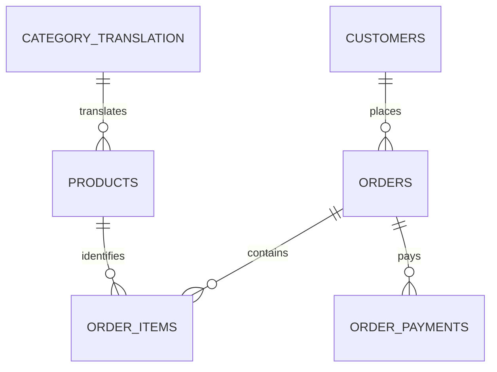

# Data model and KPI contract

| Relation | Grain / key |
| --- | --- |
| orders | One row per order_id |
| order_items | One row per (order_id, order_item_id) |
| order_payments | One payment record per (order_id, payment_sequential); an order can have multiple payments |
| products | One row per product_id |
| customers | One row per customer_id (not a repeat-customer identity) |
| category_translation | One row per source category |

## KPI definitions

Scope: `order_status='delivered'`, dated by purchase timestamp (no timezone conversion; timezone not supplied).

- Product value: sum of item price; excludes freight. Not profit or seller commission.
- Freight: sum of item freight_value; reported separately.
- Orders: distinct order_id. Additive over mutually exclusive month/state groups, not over product categories.
- Product AOV: product value / distinct orders in the same selection. Category AOV means the category's portion of order value per order containing that category.
- Payments: sum of payment_value after preaggregation at order grain. Payment-method/category allocations use product-value shares within each order; zero-value orders use equal category weights. Allocated payment-row counts are fractional weights, not unique counts.
- Category share: category value / value of ALL categories including Unknown. Left joins preserve unclassified items.

`portfolio_queries.sql` Q items exports month/state/category aggregates. Q orders aggregates items and payments independently before joining 1:1. Q payment_allocation retains method detail using weights whose sum is one per order. There is no direct many-to-many item/payment sum.

## Time contract

2016 and 2018 are partial observation windows. 2017 has all 12 months represented, but this does not prove complete source coverage. Matched Jan–Jul windows avoid the truncated final August 2018. Do not pool month numbers across unequal years to infer recurring seasonality. Missing months do not imply zero demand.

## Validation

The exporter fails on duplicate dimension/item keys, orphan orders, invalid/null/negative item values, delivered orders without items or monetary reconciliation differences above R$0.01. Diagnostics for unknown categories and observed coverage are published separately. Public artifacts contain aggregates only; raw customer identities are not exported.
